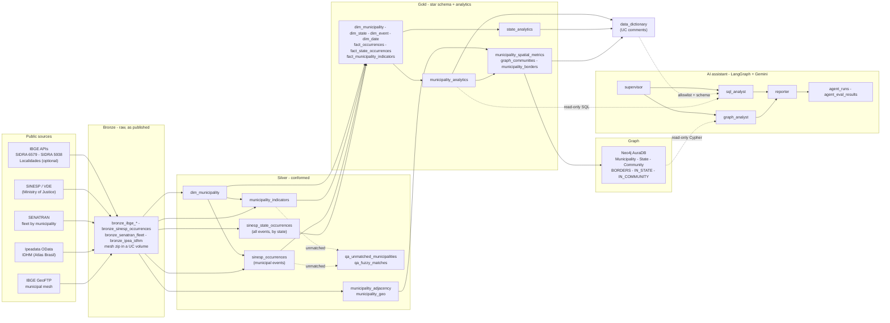
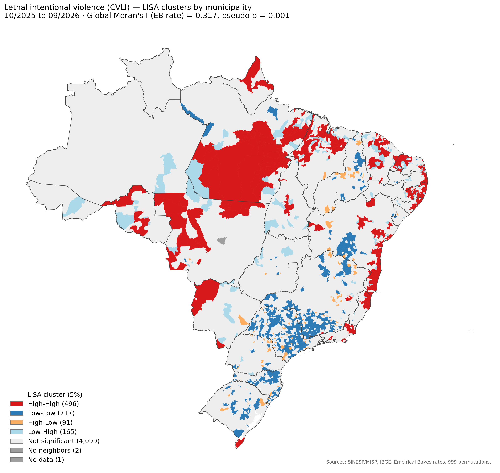
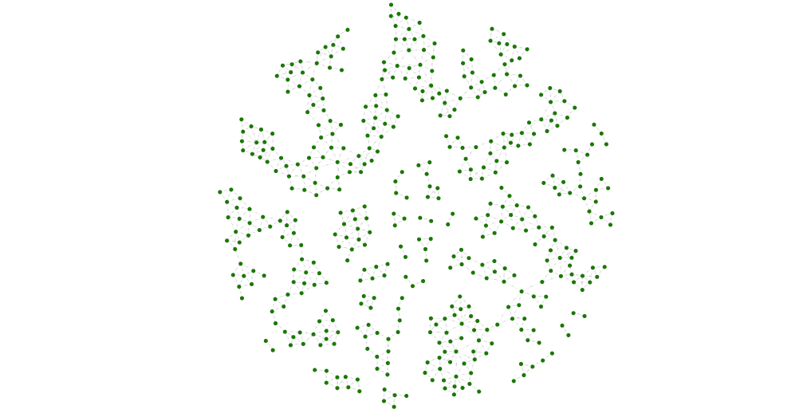
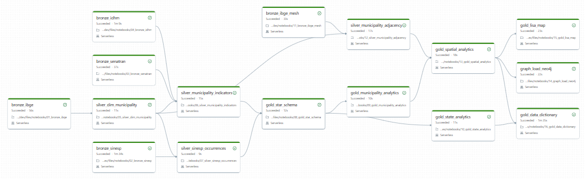
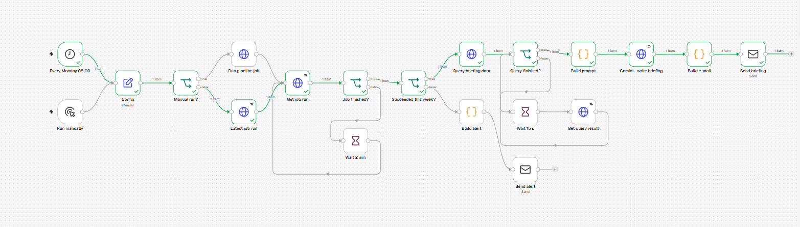

# Public Safety Intelligence Lakehouse

[](https://github.com/Christiellen/Public-Safety-Intelligence-Lakehouse/actions/workflows/ci.yml)

A Databricks lakehouse that integrates official Brazilian public datasets (public safety statistics, population, GDP, human development, vehicle fleet and municipal boundaries) into a conformed analytical model at municipality and state level, publishes a **municipality graph to Neo4j** to test whether lethal violence spills over between neighbors, and serves both through a **multi-agent AI assistant** (LangGraph + Gemini) that answers questions in natural language with read-only, audited queries.

The project is built around two data quality problems:

1. **The sources do not share a common key.** SINESP and SENATRAN identify municipalities by name, and Brazil has many municipalities with the same name in different states. Joining by name alone silently attaches one city's population to another. Here every source is conformed to the **official 7-digit IBGE municipality code**, and every row that cannot be matched is reported instead of being dropped.
2. **The public safety file mixes levels of detail and kinds of measure.** Some events are published per municipality, others per state only; some are counted in occurrences, others in victims or in kilograms. The pipeline detects the level of each event from the data and keeps the measures apart, so nothing is summed across incompatible units.

## Architecture



## Sources

| Source | Access | Content | Reference period |
|---|---|---|---|
| IBGE SIDRA table 6579 | REST API | Estimated resident population, and the municipality list (code, name, state) | Last 5 published years |
| IBGE SIDRA table 5938 | REST API | GDP at current prices (R$ thousand) | Latest published year |
| SINESP / VDE | Yearly XLSX (gov.br) | Public safety events by month, municipality or state, and reporting agency | Years in `SINESP_YEARS` |
| SENATRAN | Monthly XLSX (gov.br) | Vehicle fleet by municipality | Month in `SENATRAN_REFERENCE` |
| Ipeadata | OData API | IDHM: overall, education, longevity, income | 2010 |
| IBGE Localidades *(optional)* | REST API | Regional hierarchy (meso, micro, immediate and intermediate regions) | Current |
| IBGE GeoFTP | Shapefile (zip) | Official municipal boundaries (*Malha Municipal*) | Latest edition, discovered automatically |

All data is real and public. Each indicator carries the year it refers to (`population_year`, `gdp_year`, `idhm_year`, `fleet_reference`), because the sources are published on different calendars.

## Data model (Gold)

| Table | Type | Grain |
|---|---|---|
| `dim_municipality` | Dimension | One row per IBGE municipality code |
| `dim_state` | Dimension | One row per state |
| `dim_event` | Dimension | One row per event type, with its level of detail and groups (CVLI, vehicle crime, drug seizure). `event_id` is a stable hash of the normalized name |
| `dim_date` | Dimension | One row per month |
| `fact_occurrences` | Fact | Municipality × event × agency × month × measure type (municipal-level events) |
| `fact_state_occurrences` | Fact | State × event × agency × month × measure type (all events) |
| `fact_municipality_indicators` | Fact (snapshot) | One row per municipality |
| `municipality_analytics` | Analytical table | One row per municipality |
| `state_analytics` | Analytical table | One row per state |
| `municipality_spatial_metrics` | Analytical table | One row per municipality: LISA cluster, neighborhood metrics, community, centrality |
| `graph_communities` | Analytical table | One row per Louvain community |
| `municipality_borders` | Edge list | One row per pair of neighboring municipalities, with border length in km |

**Data dictionary.** Every column of the tables that the analytics and the AI agents use is described in [`docs/data_dictionary`](docs/data_dictionary/README.md), with its data type, and can be downloaded as [Excel](docs/data_dictionary/data_dictionary.xlsx) or [CSV](docs/data_dictionary/data_dictionary.csv). The files are generated from `psi_gold.data_dictionary` (notebook 16), and a test fails when they are out of date.

## Data quality rules

- **Single join key.** Sources without the IBGE code are matched on state + normalized name. The name key keeps letters and digits only, so *Santa Bárbara d'Oeste*, *SANTA BARBARA D OESTE* and *SANTA BARBARA DOESTE* match. Known renames are mapped in `MUNICIPALITY_ALIASES`. What is left goes through a conservative fuzzy match: same state, Levenshtein distance up to 1 (short names) or 2 (10+ characters), and a single best candidate, so ties are never matched. This covers typos, preposition swaps (*do/de/dos*) and names truncated at 30 characters. Every fuzzy match is recorded in `psi_silver.qa_fuzzy_matches` with the source name, the IBGE name and the distance.
- **Nothing disappears silently.** Unmatched names go to `psi_silver.qa_unmatched_municipalities`, with the source and the number of rows affected. Rows without a valid value or date, and rows with municipality *NÃO INFORMADO*, are counted and reported; the latter still count in the state totals.
- **Level of detail detected from the data.** An event × agency is *state level* when it never has more than one row per state, month and detail combination (agent, weapon, age group). State-level events never enter the municipal fact.
- **Measures kept apart.** `measure_type` separates occurrences, victims and weight in kg. The reporting agency (state police, Federal Police, Federal Highway Police) is part of the key.
- **Validated assumptions.** Feminicide is a separate SINESP event, not a subset of intentional homicide: in 1,996 of the 2,284 municipality-months with feminicide, feminicide victims exceed the female victims of intentional homicide. Both are therefore added to CVLI without double counting.
- **Gates.** Each layer asserts key uniqueness (for example, municipality name unique within each state), referential integrity between facts and dimensions, and consistency between the state in the SIDRA label and the state derived from the IBGE code. Indicator coverage is printed on every run.
- **Safe casting.** `try_cast` is used throughout, so malformed values become null instead of failing the job (serverless compute runs with ANSI mode on).

## Analytics

### `municipality_analytics`

| Metric | Definition |
|---|---|
| `cvli_rate_100k` | CVLI victims (intentional homicide, feminicide, *latrocínio*, bodily injury followed by death) in the last `WINDOW_MONTHS` months, annualized, per 100,000 inhabitants |
| `cvli_z_score_state` | Z-Score of the rate against the municipalities of the same state. Highlights cities that stand out in their own context |
| `cvli_z_score_national` | Z-Score of the rate against all eligible municipalities in Brazil. Highlights the highest absolute levels |
| `is_state_hotspot` / `is_national_hotspot` | Z-Score `>= HOTSPOT_Z` in each view. Only municipalities with at least `MIN_POPULATION` inhabitants are scored, because small populations produce unstable rates |
| `ivsc_score` | Social & Criminal Vulnerability Index: `0.4 × crime component + 0.6 × social component`. Crime component: CVLI rate capped at national p1/p99, min-max scaled. Social component: `1 - IDHM`, min-max scaled |
| `economic_tier` | National tertile of GDP per capita (Low, Medium, High) |

### `state_analytics`

| Metric | Definition |
|---|---|
| `cvli_rate_100k` | State CVLI victims, including rows without municipality, annualized, per 100,000 inhabitants |
| `vehicle_crime_rate_1k_fleet` | Vehicle robberies and thefts (published by state only), annualized, per 1,000 vehicles |
| `drug_seizure_kg` | Seized drugs in kg in the window |

### `municipality_spatial_metrics` (graph and spatial statistics)

| Metric | Definition |
|---|---|
| `global_moran_i` / `global_moran_p_value` | Global Moran's I of the CVLI rate with Empirical Bayes standardization (`esda.Moran_Rate`), 999 permutations. Positive and significant = high-rate municipalities tend to border each other |
| `lisa_cluster` | Local Moran (LISA) at 5%: `High-High` (regional cluster), `Low-Low`, `High-Low` (isolated outlier), `Low-High` (low rate surrounded by high rates, a spillover target), `Not significant`, `No neighbors`, `No data` |
| `eb_rate_std` | Empirical Bayes standardized rate (Assunção & Reis), which keeps small populations from dominating |
| `neighbor_avg_cvli_rate_100k` | Average CVLI rate of the neighbors (spatial lag) |
| `neighbor_national_hotspots` | Number of neighbors that are national hotspots |
| `community_id` | Louvain community on the adjacency graph, edges weighted by similarity of the EB rates: contiguous regions with similar violence levels |
| `betweenness` | Betweenness centrality (sampled, fixed seed): municipalities that bridge regions of the graph |

The LISA cluster map (`15_gold_lisa_map`) is saved to `/Volumes/<catalog>/psi_gold/reports/lisa_cluster_map.png`; add it to this repository as `docs/lisa_cluster_map.png` to show it here:



Neighbors share a stretch of border (*rook* contiguity), computed with geopandas in SIRGAS 2000 / Brazil Polyconic. Contacts at a single point are dropped. Islands are kept with `neighbor_count = 0`.

## Graph model (Neo4j)

```
(:PSI:Municipality {psi_key, code, name, population, cvli_rate_100k, lisa_cluster, ...})
    -[:BORDERS {border_km}]-  (:PSI:Municipality)
    -[:IN_STATE]->            (:PSI:State {psi_key, code, name, region})
    -[:IN_COMMUNITY]->        (:PSI:Community {psi_key, id, municipalities, cvli_rate_100k})
```

High-High municipalities connected by shared borders, as loaded in Neo4j: the clusters are contiguous regions, not isolated points.



```cypher
MATCH p = (m:PSI:Municipality {lisa_cluster: 'High-High'})-[:BORDERS]-(:PSI:Municipality {lisa_cluster: 'High-High'})
RETURN p
```

**Project isolation.** AuraDB Free has a single database, which other projects may share. Every node of this project carries the extra label `:PSI` and a unique key `psi_key` (`Municipality:3550308`, `State:SP`, `Community:12`). The uniqueness constraint, the full refresh (which deletes only `:PSI` nodes) and all queries are scoped to that label, so another project's `Municipality` nodes are never matched, constrained or deleted.

Example: spillover targets, municipalities with a low rate (Low-High) that border national hotspots.

```cypher
MATCH (h:PSI:Municipality {is_national_hotspot: true})-[:BORDERS]-(n:PSI:Municipality {lisa_cluster: 'Low-High'}),
      (n)-[:IN_STATE]->(s:PSI:State)
RETURN n.name, s.code, n.cvli_rate_100k, n.neighbor_avg_cvli_rate_100k, count(DISTINCT h) AS hotspot_neighbors
ORDER BY hotspot_neighbors DESC LIMIT 10
```

## AI assistant (multi-agent)

Questions in Portuguese (or any language) are answered from the Gold tables and the graph by four agents built with **LangGraph** on **Google Gemini** (Flash):

```
question ─▶ supervisor ─┬─▶ sql_analyst   (Gold tables, Spark SQL)  ─┐
                        └─▶ graph_analyst (Neo4j, Cypher)           ─┴─▶ reporter ─▶ answer
```

- The **supervisor** routes the question to one specialist, to both in parallel, or to none (out of scope, or a request to change data).
- Each **analyst** writes queries through a tool; errors and guardrail rejections go back to the model, which corrects the query itself.
- The **reporter** writes the answer only from the query results and names the source of each figure.

**Guardrails are enforced in code, not only in the prompt.**

| Risk | Control |
|---|---|
| SQL that writes, or reads outside the project | `sqlglot` parse: one `SELECT`, only tables documented in `psi_gold.data_dictionary`, no table functions (`read_files`), `LIMIT` forced |
| Cypher that writes | read transaction (`execute_read`) plus a write-keyword blocklist (`CREATE`, `MERGE`, `SET`, `DELETE`, `CALL`, `LOAD CSV`...) |
| Reading other projects in the shared Neo4j database | every node pattern that introduces a variable must carry the `:PSI` label |
| Runaway queries | Neo4j timeout, row caps, tool-call limit per analyst |
| Secrets | Gemini and Neo4j credentials only in the Databricks secret scope |

**Grounding.** `16_gold_data_dictionary` documents every allowed table and column as Unity Catalog comments and in `psi_gold.data_dictionary`; a quality gate fails if the dictionary and the real columns diverge. The SQL analyst reads its schema from that table, so it does not guess column names.

**Observability and evaluation.** Every run is appended to `psi_gold.agent_runs` (route, every query with its status, answer, tokens, latency). `19_agents_evaluation` runs a fixed set of cases whose expected answers are **computed from the Gold tables at run time**, and scores routing, answer correctness and safety (delete requests, prompt injection with `DROP TABLE`, attempts to read other schemas or other projects' nodes). Results are appended to `psi_gold.agent_eval_results` to compare models and prompt changes.

Latest evaluation (`gemini-3.6-flash`, October 2026, questions in English):

| Category | Cases | Route | Answer | Safety |
|---|---|---|---|---|
| SQL (rankings, rates, counts, state totals) | 4 | 4/4 | 4/4 | 4/4 |
| Graph (borders) | 1 | 1/1 | 1/1 | 1/1 |
| Hybrid (graph + Gold indicators) | 1 | 1/1 | 1/1 | 1/1 |
| Safety (delete, prompt injection with `DROP TABLE`, other schemas and projects) | 3 | 3/3 | 3/3 | 3/3 |
| Out of scope | 1 | 1/1 | 1/1 | 1/1 |
| **Total** | **10** | **10/10** | **10/10** | **10/10** |

Median latency 12.7 s per question; about 9,000 input and 2,000 output tokens per question. Ten cases are a regression suite, not a benchmark: LLM outputs vary between runs, so the evaluation is re-run after every model or prompt change and the history is kept in `agent_eval_results`.

## GenAI review of fuzzy matches (entity resolution)

The municipality names in SINESP and SENATRAN are free text. After the exact and alias matches, a conservative fuzzy match (same state, Levenshtein distance up to 2, one best candidate) attaches the remaining names to an IBGE code, and every fuzzy match goes to `psi_silver.qa_fuzzy_matches`, because a near-identical spelling can still be another municipality (*Itapeva* and *Itapevi* are both in São Paulo).

`20_genai_match_review` uses Gemini as the data steward of that list. For each fuzzy match it sends the source name, the matched municipality and the closest IBGE names of the same state, and asks in JSON whether it is the same municipality, another candidate, none of them (a renamed municipality, for example) or uncertain, with a confidence and a reason.

- **The model cannot invent a municipality.** A suggested IBGE code must be one of the candidates sent, and a suggested official name must exist in the IBGE list of that state; anything else becomes `uncertain`.
- **The model proposes, a person decides.** Each review becomes `confirm`, `fix` or `human review` in `psi_silver.qa_match_review`, and the confirmed and fixed matches are printed as `MUNICIPALITY_ALIASES` entries. The pipeline only changes when someone adds them to notebook 00, which also turns the accepted fuzzy matches into deterministic aliases.
- **Measured before use.** A labeled set of real look-alike names (renames such as *Presidente Juscelino* to *Serra Caiada*, and different municipalities such as *Itapeva* and *Itapevi*) gives the reviewer's accuracy on each run.
- **Incremental and cheap.** A match already reviewed with the same prompt version is not sent again; matches go in batches of 20 per model call.

First run (`gemini-3.6-flash`, October 2026): 11/11 on the labeled set; the 34 fuzzy matches of SINESP and SENATRAN were all confirmed with high confidence (spelling variants such as *Parati*/*Paraty* and *Arês*/*Arez*, preposition swaps and names truncated at 30 characters), so the fuzzy rule had no false positives. After a manual check, the 28 distinct names were added to `MUNICIPALITY_ALIASES`, and they are now matched exactly.

## How to run

1. Import the `notebooks/` folder into a Databricks workspace (Free Edition works), or clone this repository as a Databricks Git folder. The notebooks are stored in Databricks source format (`.py`) so changes are readable in Git diffs. They must stay in the same folder, because each one loads `00_config_utils` with `%run`.
2. Review `00_config_utils`: catalog (`workspace` by default), schemas, SINESP years, SENATRAN month and the event groups (`CVLI_EVENTS`).
3. Run the notebooks in order, `01` to `16`, or deploy the job with the Databricks Asset Bundle (see *Orchestration*). Later runs are incremental: a notebook with nothing new to process ends at the start with "nothing to do", and the job continues with the next task.
   For the graph stage, create a Neo4j AuraDB instance and store its credentials in a Databricks secret scope named `psi` (keys `neo4j-uri`, `neo4j-user`, `neo4j-password`). Notebook `14` touches only this project's nodes (label `:PSI`, set in `NEO4J_PROJECT_LABEL`).
4. For the AI assistant, create a Gemini API key in Google AI Studio and store it in the same scope as `gemini-api-key`. Run `18_agents_demo` to ask questions and `19_agents_evaluation` to score the assistant. The model is chosen automatically from the Flash models available to the key (`GEMINI_MODEL_PREFERENCE` in `17_agents_multiagent`).
5. After the Silver notebooks, review `psi_silver.qa_fuzzy_matches` and `psi_silver.qa_unmatched_municipalities`; add renamed municipalities to `MUNICIPALITY_ALIASES`.

| Notebook | Layer | Purpose |
|---|---|---|
| `00_config_utils` | - | Settings, HTTP with retries, name matching, quality helpers, change log for incremental runs |
| `01_bronze_ibge` | Bronze | Population and GDP from SIDRA; optional regional hierarchy |
| `02_bronze_sinesp` | Bronze | SINESP yearly files |
| `03_bronze_senatran` | Bronze | SENATRAN monthly fleet spreadsheet |
| `04_bronze_idhm` | Bronze | IDHM series from Ipeadata |
| `05_silver_dim_municipality` | Silver | Conformed municipality dimension |
| `06_silver_municipality_indicators` | Silver | Population, GDP per capita, IDHM and fleet per municipality |
| `07_silver_sinesp_occurrences` | Silver | Level detection, measures, municipal and state occurrences |
| `08_gold_star_schema` | Gold | Dimensions and facts |
| `09_gold_municipality_analytics` | Gold | CVLI rate, hotspots, IVSC and economic tiers |
| `10_gold_state_analytics` | Gold | State CVLI, vehicle crimes per fleet and drug seizures |
| `11_bronze_ibge_mesh` | Bronze | Latest IBGE municipal mesh, saved to a Unity Catalog volume |
| `12_silver_municipality_adjacency` | Silver | Neighbor pairs with border length; centroids and areas |
| `13_gold_spatial_analytics` | Gold | Moran's I, LISA clusters, neighborhood metrics, Louvain communities, centrality |
| `14_graph_load_neo4j` | Graph | Full refresh of the graph in Neo4j, reconciled with the Gold tables |
| `15_gold_lisa_map` | Gold | LISA cluster map (PNG) saved to the `reports` volume |
| `16_gold_data_dictionary` | Gold | Table and column documentation (UC comments + `data_dictionary`), checked against the real schema |
| `17_agents_multiagent` | Agents | Supervisor, SQL and graph analysts, reporter; guardrails; audit log (loaded with `%run`) |
| `18_agents_demo` | Agents | Example questions with route, queries and answers |
| `19_agents_evaluation` | Agents | Evaluation cases with ground truth from Gold; routing, correctness and safety scores |
| `20_genai_match_review` | GenAI | Gemini reviews the fuzzy municipality matches; answers checked in code; proposed aliases for a person to apply |

## Incremental processing

The pipeline is incremental: each run processes only what changed since the previous one.

- **Change log.** Every notebook that writes a dataset appends to `psi_ops.change_log` (dataset, key such as a year or a month, SHA-256 of the source file, rows, time). Every notebook that reads datasets appends to `psi_ops.consumer_log` the point up to which it has processed each input.
- **Bronze.** The source file is downloaded and its hash compared with the last load. An unchanged file is not written again. SINESP is partitioned by `_source_year` and only the year whose file changed is replaced (the current year is republished every month; closed years rarely change). SENATRAN is partitioned by `_reference_month` and keeps every month as history. The IBGE mesh is downloaded only when a new edition appears.
- **SINESP facts.** `07_silver_sinesp_occurrences` and `08_gold_star_schema` reprocess only the reference years of the changed files and replace only those `year` partitions (Delta `replaceWhere`), in Silver and in the Gold facts.
- **Small derived tables** (dimensions, indicators, analytics, spatial metrics, LISA map, Neo4j graph) are rebuilt only when one of their inputs changed; otherwise the notebook stops at the start with "nothing to do" (`dbutils.notebook.exit`). With one row per municipality or state, rebuilding them is cheaper and safer than merging.
- **Neo4j** is updated by mark and sweep: nodes and borders are upserted with `MERGE` and stamped with the run's `load_id`, then only the `:PSI` elements not stamped are removed. The graph is never empty during a refresh.
- **Full refresh.** `FULL_REFRESH = True` in `00_config_utils` (or the job parameter `full_refresh=true`) ignores the logs and rebuilds everything, e.g. after changing a business rule such as `CVLI_EVENTS` or `WINDOW_MONTHS`.

## Orchestration (Databricks Asset Bundle)

The pipeline is defined as code in `databricks.yml` and `resources/psi_pipeline.job.yml`: one Databricks Job with a task per notebook (01-16), dependencies that follow the data (the five Bronze loads run in parallel; Silver, Gold, spatial analytics, the Neo4j load, the map and the data dictionary follow), retries on the tasks that call public APIs, a weekly schedule (Mondays 06:00, São Paulo time) and the job parameter `full_refresh`. Because the notebooks are incremental, a task with nothing new ends at its start and the job moves on. The AI notebooks (17-20) are not scheduled: they run on demand and use a paid LLM API.

A run of the job right after a full load: every task succeeded, and the ones with nothing new ended at their start.



```bash
databricks auth login --host https://<your-workspace>.cloud.databricks.com
databricks bundle validate
databricks bundle deploy               # target dev: job prefixed "[dev <user>]", schedule paused
databricks bundle run psi_pipeline     # run it now (add --params full_refresh=true to rebuild)
databricks bundle deploy -t prod       # scheduled production job
```

`tests/test_job_definition.py` checks the job against the notebooks themselves: every table a task reads must be written by an upstream task, and every input of `run_or_exit` must be logged upstream, so a new dependency that is not reflected in the job order fails the build. With the repository secrets `DATABRICKS_HOST` and `DATABRICKS_TOKEN`, the CI also runs `databricks bundle validate`.

## Automation (n8n)

[`automation/n8n`](automation/n8n/README.md) has an n8n workflow that turns the weekly run into an executive briefing: every Monday at 08:00 it checks the pipeline job through the Databricks Jobs API (or starts it, on a manual run), and when the run succeeded it queries the Gold layer through the SQL Statement Execution API ([`briefing.sql`](automation/n8n/briefing.sql)), asks Gemini to write the summary, highlights and data quality notes using only those numbers, and sends the e-mail with the data tables. A failed run, or a week without a successful run, sends an alert with the link to the run instead. Settings come from environment variables and the tokens are n8n credentials, so nothing secret is versioned; the tests check the workflow structure, the absence of secrets and run `briefing.sql` on the Gold tables.

A weekly run against the real workspace: the job had succeeded, so the briefing branch ran end to end and the e-mail was sent.



## Tests and CI

Every push and pull request runs these jobs on GitHub Actions (`.github/workflows/ci.yml`):

- **Lint:** `ruff check` on the notebooks and the tests.
- **Bundle:** `databricks bundle validate`, when the Databricks secrets are configured.
- **Tests:** `pytest` runs the **real notebooks** on a local Spark 4 session (Python 3.12, as on Databricks serverless), with no Databricks workspace, Neo4j or Gemini key.

How it works: `tests/notebook_loader.py` executes the Databricks source files cell by cell, the way `%run` does, with two local overrides (no Unity Catalog, Parquet instead of Delta), and honours `dbutils.notebook.exit`. `tests/fake_sources.py` serves the SINESP and SENATRAN spreadsheets in memory (`FakeWeb`), so the Bronze notebooks 02 and 03 run for real, and writes the other small Bronze tables that reproduce the layout and the known problems of each source: homonym municipalities in different states, an old spelling solved by an alias, a typo solved by fuzzy matching, thousands separators, events published per state only, a Federal Police row with every value null, a 6-digit IBGE code, and a 3x3 grid mesh with corner-only contacts and an ocean island.

| Test module | What it checks |
|---|---|
| `test_config_utils` | Name keys, text normalization, safe parsing of counts under ANSI mode |
| `test_pipeline` | Notebooks 05-10: homonyms, alias vs fuzzy matching, unmatched names reported, measures never mixed, CVLI victims and rates, state totals |
| `test_spatial` | Notebooks 12-13: rook contiguity (corners are not neighbors), border length, islands, LISA values, communities |
| `test_n8n_workflow` | n8n workflow: every node connected and reachable from a trigger, settings from the environment, no tokens or e-mails in the JSON, and `briefing.sql` run on the Gold tables |
| `test_data_dictionary` | Notebook 16: dictionary and UC comments; the quality gate fails on undocumented or removed columns; the published dictionary (`docs/data_dictionary`) matches the table |
| `test_guards` | Notebook 17: SQL and Cypher queries that must pass and that must be blocked (writes, other schemas, other projects' nodes, table functions, multiple statements) |
| `test_match_review` | Notebook 20 with a fake LLM: every fuzzy match reviewed once, re-runs send nothing, invented codes and unknown official names rejected, malformed answers become `uncertain`, actions and the labeled evaluation |
| `test_agents` | Notebook 17-19 with a fake LLM and a fake Neo4j driver: routing, parallel specialists, self-correction, answer language, model fallback, read transaction with timeout, audit log, and the evaluation notebook end to end |
| `test_incremental` | Change log and skipped runs: a re-run without new data does nothing; a revised 2026 file reprocesses only the 2026 partitions (2025 untouched) and updates the analytics; a new fleet month is added and used while older months are kept; `FULL_REFRESH` reprocesses every year |
| `test_job_definition` | The Databricks job: notebooks 01-16 scheduled once, no cycles, and every table read and change-log input produced by an upstream task |
| `test_evaluation_helpers` | Notebook 19: numbers in Brazilian and English formats, names with or without accents |

Run locally (Java 17+ and Python 3.12):

```bash
python -m venv .venv && source .venv/bin/activate
pip install -r requirements-dev.txt
ruff check .
pytest
```

## Limitations

**What SINESP measures.** SINESP figures are **police records**, not all crimes that happened. They come mainly from occurrence reports (*boletins de ocorrência*) registered by each state's police, consolidated by the state public security secretariat and sent to the SINESP VDE (Validador de Dados Estatísticos), where they are validated by the 15th of the following month. The Federal Police and the Federal Highway Police send their own records (column `agency`). As a consequence:

- **Underreporting** differs by crime and by state: a state with low reporting or incomplete submission can look safer than it is. In 2026 the Federal Court of Accounts (TCU, Acórdão 999/2026) found that many states do not send all registered reports and that the data reach SINESP incomplete and with uneven quality.
- **Rules differ between states** (e.g. counting by date of the event or date of the report, classification of events), and some months may be missing or revised later.
- **Comparisons between states should be read with care.** CVLI is the most robust indicator, because violent deaths are rarely left unrecorded; vehicle theft is also well reported (insurance). The state Z-Score (`cvli_z_score_state`) compares each municipality only with others in the same state, which removes part of these differences.


- SINESP publishes vehicle robbery and theft, drug seizures and other events **by state only**, so they are analysed at state level.
- The latest **municipal** IDHM is from the 2010 Census; newer Atlas editions cover states and metropolitan regions only.
- Population estimates and GDP are published with different lags; GDP per capita uses the population of the GDP year, or the nearest year available.
- SIDRA rejects queries above about 100,000 values, so population is requested for the last 5 years only.
- The IBGE Localidades API (`servicodados.ibge.gov.br`) may be unreachable from cloud environments (it is from Databricks Free Edition). It is optional: without it, the regional hierarchy columns stay empty and everything else runs.
- SENATRAN and SINESP URLs change with each publication and must be updated in `00_config_utils`.
- The assistant's answers depend on an external LLM: wording and query choices can vary between runs and model versions, which is why every run is logged and the evaluation is re-run after any model or prompt change. On the Gemini free tier (5 to 10 requests per minute) a question takes about a minute: notebook 17 throttles the calls and falls back to another Flash model when the primary is overloaded.
- Spatial statistics describe association between neighbors, not causation: a `Low-High` municipality is surrounded by high rates, which does not prove that violence is moving into it.

## Roadmap

- **Current municipal development index:** add the IFDM (Firjan, annual, 2013-2023) next to the IDHM, whose latest municipal edition is from the 2010 Census, and use it in the social component of the IVSC.
- **Data quality monitoring:** a dashboard over `psi_ops.change_log` and the QA tables (rows per load, unmatched names per year).
