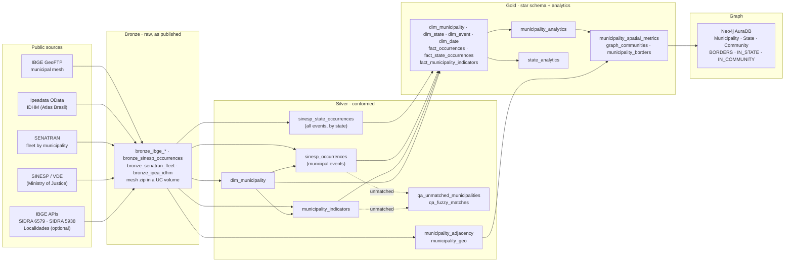

# Public Safety Intelligence Lakehouse

A Databricks lakehouse that integrates official Brazilian public datasets (public safety statistics, population, GDP, human development, vehicle fleet and municipal boundaries) into a conformed analytical model at municipality and state level, and publishes a **municipality graph to Neo4j** to test whether lethal violence spills over between neighbors.

The project is built around two data quality problems:

1. **The sources do not share a common key.** SINESP and SENATRAN identify municipalities by name, and Brazil has many municipalities with the same name in different states. Joining by name alone silently attaches one city's population to another. Here every source is conformed to the **official 7-digit IBGE municipality code**, and every row that cannot be matched is reported instead of being dropped.
2. **The public safety file mixes levels of detail and kinds of measure.** Some events are published per municipality, others per state only; some are counted in occurrences, others in victims or in kilograms. The pipeline detects the level of each event from the data and keeps the measures apart, so nothing is summed across incompatible units.

## Architecture



## Sources

| Source | Access | Content | Reference period |
|---|---|---|---|
| IBGE SIDRA table 6579 | REST API | Estimated resident population, and the municipality list (code, name, state) | Last 5 published years |
| IBGE SIDRA table 5938 | REST API | GDP at current prices (R$ thousand) | Latest published year |
| SINESP / VDE | Yearly XLSX (gov.br) | Public safety events by month, municipality or state, and reporting agency | Years in `SINESP_YEARS` |
| SENATRAN | Monthly XLSX (gov.br) | Vehicle fleet by municipality | Month in `SENATRAN_REFERENCE` |
| Ipeadata | OData API | IDHM: overall, education, longevity, income | 2010 |
| IBGE Localidades *(optional)* | REST API | Regional hierarchy (meso, micro, immediate and intermediate regions) | Current |
| IBGE GeoFTP | Shapefile (zip) | Official municipal boundaries (*Malha Municipal*) | Latest edition, discovered automatically |

All data is real and public. Each indicator carries the year it refers to (`population_year`, `gdp_year`, `idhm_year`, `fleet_reference`), because the sources are published on different calendars.

## Data model (Gold)

| Table | Type | Grain |
|---|---|---|
| `dim_municipality` | Dimension | One row per IBGE municipality code |
| `dim_state` | Dimension | One row per state |
| `dim_event` | Dimension | One row per event type, with its level of detail and groups (CVLI, vehicle crime, drug seizure). `event_id` is a stable hash of the normalized name |
| `dim_date` | Dimension | One row per month |
| `fact_occurrences` | Fact | Municipality × event × agency × month × measure type (municipal-level events) |
| `fact_state_occurrences` | Fact | State × event × agency × month × measure type (all events) |
| `fact_municipality_indicators` | Fact (snapshot) | One row per municipality |
| `municipality_analytics` | Analytical table | One row per municipality |
| `state_analytics` | Analytical table | One row per state |
| `municipality_spatial_metrics` | Analytical table | One row per municipality: LISA cluster, neighborhood metrics, community, centrality |
| `graph_communities` | Analytical table | One row per Louvain community |
| `municipality_borders` | Edge list | One row per pair of neighboring municipalities, with border length in km |

## Data quality rules

- **Single join key.** Sources without the IBGE code are matched on state + normalized name. The name key keeps letters and digits only, so *Santa Bárbara d'Oeste*, *SANTA BARBARA D OESTE* and *SANTA BARBARA DOESTE* match. Known renames are mapped in `MUNICIPALITY_ALIASES`. What is left goes through a conservative fuzzy match: same state, Levenshtein distance up to 1 (short names) or 2 (10+ characters), and a single best candidate, so ties are never matched. This covers typos, preposition swaps (*do/de/dos*) and names truncated at 30 characters. Every fuzzy match is recorded in `psi_silver.qa_fuzzy_matches` with the source name, the IBGE name and the distance.
- **Nothing disappears silently.** Unmatched names go to `psi_silver.qa_unmatched_municipalities`, with the source and the number of rows affected. Rows without a valid value or date, and rows with municipality *NÃO INFORMADO*, are counted and reported; the latter still count in the state totals.
- **Level of detail detected from the data.** An event × agency is *state level* when it never has more than one row per state, month and detail combination (agent, weapon, age group). State-level events never enter the municipal fact.
- **Measures kept apart.** `measure_type` separates occurrences, victims and weight in kg. The reporting agency (state police, Federal Police, Federal Highway Police) is part of the key.
- **Validated assumptions.** Feminicide is a separate SINESP event, not a subset of intentional homicide: in 1,996 of the 2,284 municipality-months with feminicide, feminicide victims exceed the female victims of intentional homicide. Both are therefore added to CVLI without double counting.
- **Gates.** Each layer asserts key uniqueness (for example, municipality name unique within each state), referential integrity between facts and dimensions, and consistency between the state in the SIDRA label and the state derived from the IBGE code. Indicator coverage is printed on every run.
- **Safe casting.** `try_cast` is used throughout, so malformed values become null instead of failing the job (serverless compute runs with ANSI mode on).

## Analytics

### `municipality_analytics`

| Metric | Definition |
|---|---|
| `cvli_rate_100k` | CVLI victims (intentional homicide, feminicide, *latrocínio*, bodily injury followed by death) in the last `WINDOW_MONTHS` months, annualized, per 100,000 inhabitants |
| `cvli_z_score_state` | Z-Score of the rate against the municipalities of the same state. Highlights cities that stand out in their own context |
| `cvli_z_score_national` | Z-Score of the rate against all eligible municipalities in Brazil. Highlights the highest absolute levels |
| `is_state_hotspot` / `is_national_hotspot` | Z-Score `>= HOTSPOT_Z` in each view. Only municipalities with at least `MIN_POPULATION` inhabitants are scored, because small populations produce unstable rates |
| `ivsc_score` | Social & Criminal Vulnerability Index: `0.4 × crime component + 0.6 × social component`. Crime component: CVLI rate capped at national p1/p99, min–max scaled. Social component: `1 − IDHM`, min–max scaled |
| `economic_tier` | National tertile of GDP per capita (Low, Medium, High) |

### `state_analytics`

| Metric | Definition |
|---|---|
| `cvli_rate_100k` | State CVLI victims, including rows without municipality, annualized, per 100,000 inhabitants |
| `vehicle_crime_rate_1k_fleet` | Vehicle robberies and thefts (published by state only), annualized, per 1,000 vehicles |
| `drug_seizure_kg` | Seized drugs in kg in the window |

### `municipality_spatial_metrics` (graph and spatial statistics)

| Metric | Definition |
|---|---|
| `global_moran_i` / `global_moran_p_value` | Global Moran's I of the CVLI rate with Empirical Bayes standardization (`esda.Moran_Rate`), 999 permutations. Positive and significant = high-rate municipalities tend to border each other |
| `lisa_cluster` | Local Moran (LISA) at 5%: `High-High` (regional cluster), `Low-Low`, `High-Low` (isolated outlier), `Low-High` (low rate surrounded by high rates, a spillover target), `Not significant`, `No neighbors`, `No data` |
| `eb_rate_std` | Empirical Bayes standardized rate (Assunção & Reis), which keeps small populations from dominating |
| `neighbor_avg_cvli_rate_100k` | Average CVLI rate of the neighbors (spatial lag) |
| `neighbor_national_hotspots` | Number of neighbors that are national hotspots |
| `community_id` | Louvain community on the adjacency graph, edges weighted by similarity of the EB rates: contiguous regions with similar violence levels |
| `betweenness` | Betweenness centrality (sampled, fixed seed): municipalities that bridge regions of the graph |

The LISA cluster map (`15_gold_lisa_map`) is saved to `/Volumes/<catalog>/psi_gold/reports/lisa_cluster_map.png`; add it to this repository as `docs/lisa_cluster_map.png` to show it here:


Neighbors share a stretch of border (*rook* contiguity), computed with geopandas in SIRGAS 2000 / Brazil Polyconic. Contacts at a single point are dropped. Islands are kept with `neighbor_count = 0`.

## Graph model (Neo4j)

```
(:PSI:Municipality {psi_key, code, name, population, cvli_rate_100k, lisa_cluster, ...})
    -[:BORDERS {border_km}]-  (:PSI:Municipality)
    -[:IN_STATE]->            (:PSI:State {psi_key, code, name, region})
    -[:IN_COMMUNITY]->        (:PSI:Community {psi_key, id, municipalities, cvli_rate_100k})
```

High-High municipalities connected by shared borders, as loaded in Neo4j: the clusters are contiguous regions, not isolated points.


```cypher
MATCH p = (m:PSI:Municipality {lisa_cluster: 'High-High'})-[:BORDERS]-(:PSI:Municipality {lisa_cluster: 'High-High'})
RETURN p
```

**Project isolation.** AuraDB Free has a single database, which other projects may share. Every node of this project carries the extra label `:PSI` and a unique key `psi_key` (`Municipality:3550308`, `State:SP`, `Community:12`). The uniqueness constraint, the full refresh (which deletes only `:PSI` nodes) and all queries are scoped to that label, so another project's `Municipality` nodes are never matched, constrained or deleted.

Example: spillover targets, municipalities with a low rate (Low-High) that border national hotspots.

```cypher
MATCH (h:PSI:Municipality {is_national_hotspot: true})-[:BORDERS]-(n:PSI:Municipality {lisa_cluster: 'Low-High'}),
      (n)-[:IN_STATE]->(s:PSI:State)
RETURN n.name, s.code, n.cvli_rate_100k, n.neighbor_avg_cvli_rate_100k, count(DISTINCT h) AS hotspot_neighbors
ORDER BY hotspot_neighbors DESC LIMIT 10
```

## How to run

1. Import the `notebooks/` folder into a Databricks workspace (Free Edition works), or clone this repository as a Databricks Git folder. The notebooks are stored in Databricks source format (`.py`) so changes are readable in Git diffs. They must stay in the same folder, because each one loads `00_config_utils` with `%run`.
2. Review `00_config_utils`: catalog (`workspace` by default), schemas, SINESP years, SENATRAN month and the event groups (`CVLI_EVENTS`).
3. Run the notebooks in order, `01` to `15`, or create a Databricks Job with one task per notebook in that sequence.
   For the graph stage, create a Neo4j AuraDB instance and store its credentials in a Databricks secret scope named `psi` (keys `neo4j-uri`, `neo4j-user`, `neo4j-password`). Notebook `14` does a full refresh of this project's nodes only (label `:PSI`, set in `NEO4J_PROJECT_LABEL`).
4. After the Silver notebooks, review `psi_silver.qa_fuzzy_matches` and `psi_silver.qa_unmatched_municipalities`; add renamed municipalities to `MUNICIPALITY_ALIASES`.

| Notebook | Layer | Purpose |
|---|---|---|
| `00_config_utils` | — | Settings, HTTP with retries, name matching, quality helpers |
| `01_bronze_ibge` | Bronze | Population and GDP from SIDRA; optional regional hierarchy |
| `02_bronze_sinesp` | Bronze | SINESP yearly files |
| `03_bronze_senatran` | Bronze | SENATRAN monthly fleet spreadsheet |
| `04_bronze_idhm` | Bronze | IDHM series from Ipeadata |
| `05_silver_dim_municipality` | Silver | Conformed municipality dimension |
| `06_silver_municipality_indicators` | Silver | Population, GDP per capita, IDHM and fleet per municipality |
| `07_silver_sinesp_occurrences` | Silver | Level detection, measures, municipal and state occurrences |
| `08_gold_star_schema` | Gold | Dimensions and facts |
| `09_gold_municipality_analytics` | Gold | CVLI rate, hotspots, IVSC and economic tiers |
| `10_gold_state_analytics` | Gold | State CVLI, vehicle crimes per fleet and drug seizures |
| `11_bronze_ibge_mesh` | Bronze | Latest IBGE municipal mesh, saved to a Unity Catalog volume |
| `12_silver_municipality_adjacency` | Silver | Neighbor pairs with border length; centroids and areas |
| `13_gold_spatial_analytics` | Gold | Moran's I, LISA clusters, neighborhood metrics, Louvain communities, centrality |
| `14_graph_load_neo4j` | Graph | Full refresh of the graph in Neo4j, reconciled with the Gold tables |
| `15_gold_lisa_map` | Gold | LISA cluster map (PNG) saved to the `reports` volume |

## Limitations

- SINESP publishes vehicle robbery and theft, drug seizures and other events **by state only**, so they are analysed at state level.
- The latest **municipal** IDHM is from the 2010 Census; newer Atlas editions cover states and metropolitan regions only.
- Population estimates and GDP are published with different lags; GDP per capita uses the population of the GDP year, or the nearest year available.
- SIDRA rejects queries above about 100,000 values, so population is requested for the last 5 years only.
- The IBGE Localidades API (`servicodados.ibge.gov.br`) may be unreachable from cloud environments (it is from Databricks Free Edition). It is optional: without it, the regional hierarchy columns stay empty and everything else runs.
- SENATRAN and SINESP URLs change with each publication and must be updated in `00_config_utils`.
- Spatial statistics describe association between neighbors, not causation: a `Low-High` municipality is surrounded by high rates, which does not prove that violence is moving into it.

## Roadmap

- **Multi-agent assistant:** agents that answer questions over the Gold tables and the graph.
- **Automation and CI:** scheduled refresh and a GitHub Actions workflow with automated tests.
