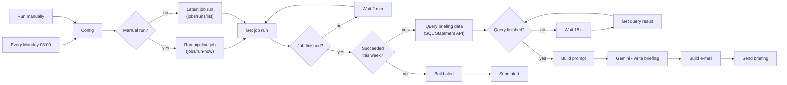

# n8n - weekly public safety briefing

Workflow `psi_weekly_briefing.json`: every Monday at 08:00 (São Paulo), after the pipeline job runs
(06:00, Databricks Asset Bundle), n8n checks the run, queries the Gold layer and sends an executive
briefing by e-mail, written by Gemini over numbers that come only from the data. If the job failed or did
not run this week, it sends an alert instead.



| Step | What it does |
|---|---|
| Triggers | Weekly schedule, or a manual run that also starts the job (`run-now`, `full_refresh=false`) |
| Job monitoring | Polls `jobs/runs/get` every 2 minutes until the run ends (at most 3 hours); a failed run, or no successful run in the last 26 hours, sends an alert with the link to the run |
| Data | [`briefing.sql`](briefing.sql) through the SQL Statement Execution API: national totals, highest and lowest state rates, hotspots among cities with 100,000+ inhabitants, LISA clusters, what changed in `psi_ops.change_log` in the last 7 days and the QA counts |
| Text | Gemini writes the summary, highlights, data quality notes and a suggested question for the AI assistant, using only the numbers it receives |
| E-mail | The tables are built from the data (not by the LLM) and sent as HTML through SMTP |

Nothing secret is versioned: settings come from environment variables and the tokens are n8n credentials
(stored encrypted by n8n). The briefing is in English by default (`BRIEFING_LANGUAGE`). `tests/test_n8n_workflow.py` checks the workflow structure, that there are no
secrets or e-mails in the JSON, that the workflow runs `briefing.sql`, and runs `briefing.sql` against the
Gold tables built by the notebooks.

## Setup

**1. Databricks**
- Job id: *Jobs & Pipelines* > the job "PSI - Lakehouse, spatial analytics and graph" > *Job ID*.
- SQL warehouse id: *SQL Warehouses* > the serverless warehouse > *Connection details* (the id is the end of the HTTP path).
- A token for n8n only (*Settings* > *Developer* > *Access tokens*), with the scopes `jobs` and `sql`.

**2. Start n8n (Docker)**

```bash
cp automation/n8n/n8n.env.example automation/n8n/n8n.env   # fill in; n8n.env is ignored by Git
docker volume create n8n_data
docker run -d --name n8n -p 5678:5678 --env-file automation/n8n/n8n.env \
  -v n8n_data:/home/node/.n8n n8nio/n8n:2.45.7
```

Open http://localhost:5678 and create the owner account.

**3. Credentials** (*Credentials* > *Add credential*):

| Type | Name | Values |
|---|---|---|
| Databricks | `Databricks` | Host = your workspace URL, Personal Access Token = the token above |
| Google Gemini(PaLM) Api | `Google Gemini` | API key from Google AI Studio |
| SMTP | `SMTP` | For Gmail: host `smtp.gmail.com`, port `465`, SSL on, user = your Gmail, password = an [app password](https://myaccount.google.com/apppasswords) |

Each service uses its own credential type, so n8n links each node to the right credential on import.

**4. Import and activate**
- *Workflows* > *Import from file* > `psi_weekly_briefing.json`; if a node shows a credential warning, open it and select the credential.
- *Execute workflow* runs it now (starting the job); *Publish/Active* turns on the Monday schedule (n8n must be running).
