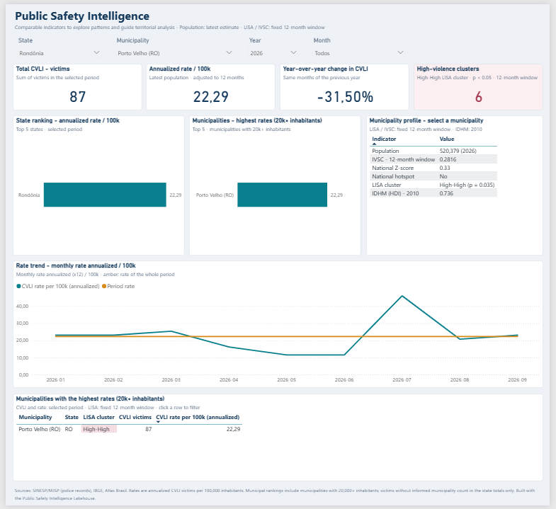

# Power BI version of the dashboard

The same dashboard as the [Superset stack](../superset/README.md), built as a Power BI project (PBIP): the semantic model in TMDL and the report in PBIR, both plain text, versioned and reviewed like code. It reads the same Gold export (`superset/data`, from notebook `21_gold_export_bi`) and applies the same rules, so both tools show the same numbers.

## Open it

1. Export the Gold layer to `superset/data` (see [`superset/data/README.md`](../superset/data/README.md)). The Power BI model needs only the `.csv.gz` files.
2. Open `PSI_Lakehouse.pbip` in Power BI Desktop (a recent version; the report uses the PBIR format).
3. If the files are not in the default folder, go to **Transform data > Edit parameters** and set **DataFolder**. The default points to the repository inside WSL:
   `\\wsl.localhost\Ubuntu\home\<user>\Public-Safety-Intelligence-Lakehouse\superset\data`
4. **Refresh**. To get a single `.pbix` file, use **File > Save as**.

## Semantic model

Star schema with one fact table at the grain area x month, and every measure in a separate, data-less table `_Measures`, organized in display folders.

| Table | Rows | Role |
|---|---|---|
| `CVLI` | area x month | CVLI victims. Municipal facts plus one **Not assigned** row per state and month (state facts minus municipal facts), so any filter adds up with plain sums |
| `Area` | 5,570 municipalities + 27 Not assigned | Population, IVSC, Z-score, hotspot, LISA cluster, IDHM |
| `State` | 27 | State and region |
| `Date` | months of the facts | Year, month, `Year month` (sorted by `Month index`) |
| `Profile item` | 6 | Rows of the municipality profile table |
| `_Measures` | none | All measures |

Relationships: `CVLI[Area key] → Area[Area key]`, `CVLI[Date ID] → Date[Date ID]`, `Area[State code] → State[State code]`, all one-to-many and single direction.

Power Query reads each Gold table with one function (`GoldTable`) from the parameter `DataFolder`; the staging queries (`CvliEvents`, `Municipalities`, `MunicipalCvli`, `StateCvli`) are not loaded.

### Measures

| Folder | Measures |
|---|---|
| Base | `CVLI victims`, `Population`, `Months in period` |
| Rates | `CVLI rate` (victims x 12 / months per 100,000 - a ratio of sums, never an average of rates), `Period rate` (reference line) |
| Year over year | `CVLI victims (previous year)`, `CVLI YoY change` (blank when any previous month is missing) |
| Spatial | `High-High municipalities` (fixed 12-month window, ignores the period and the municipality) |
| Rankings | `State rate (top 5)`, `Municipal rate (20k+)`, `Municipal rank (20k+)`, `Municipal rate (top 5)`, `Top 4 - CVLI rate`, `Top 4 - CVLI victims` |
| Profile | `Profile value` (one row per indicator, only when one municipality is selected) |
| Formatting | `LISA cluster color` (conditional formatting of the table) |

Year over year works on `Date[Month index]` (year x 12 + month) with `TREATAS`, instead of the time intelligence functions, because the date table has one row per month.

## Report

One page with the layout of the Figma prototype and the Superset dashboard: filters (state, municipality, year - 2026 by default - and month), KPI cards, state and municipal rankings, municipality profile, rate trend with the period reference line, top municipalities with the LISA cluster highlighted, and the sources.

## Checks

`tests/test_powerbi_project.py` runs in CI: every field used by a visual exists in the model, every measure lives in `_Measures`, DAX references, relationships and sort-by columns point to existing objects, and Power Query reads only tables exported by notebook 21. The model rules were also checked against the Superset views on the test data (national total, rate and year-over-year change, state rates and the top municipalities).
