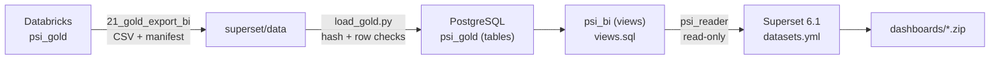

# Superset dashboard

An [Apache Superset](https://superset.apache.org/) stack over the Gold layer, that anyone can run with one command and no Databricks workspace: the Gold tables are exported as files (notebook `21_gold_export_bi`), loaded into PostgreSQL and exposed to Superset through a read-only semantic layer.



## Run

Docker with Compose v2, and a Gold export in `superset/data` (see *Refresh the data*):

```bash
cd superset
cp .env.example .env        # set the passwords and SUPERSET_SECRET_KEY (openssl rand -base64 42)
docker compose up --build
```

Open <http://localhost:8088> and sign in with `SUPERSET_ADMIN_USER` / `SUPERSET_ADMIN_PASSWORD`. The service `superset-init` prepares everything before the web server starts, and can run again on every `up`: each step skips what is already done.

| Step | What it does |
|---|---|
| Metadata | Superset database migrations, admin user, roles |
| Load | `loader/load_gold.py`: checks every file of `data/` against `manifest.json` (SHA-256, header, row count), recreates `psi_gold` with the column types of the manifest, loads with `COPY`, checks the primary keys and rebuilds the views of `psi_bi`, all in one transaction. A manifest already loaded is skipped |
| Datasets | `assets/build_assets.py` turns `assets/datasets.yml` into an import bundle (database connection + 6 datasets with column descriptions and metrics), imported with `superset import-datasources` |
| Dashboards | Every `dashboards/*.zip` is imported with `superset import-dashboards` |

## Semantic layer (`psi_bi`)

Superset connects as `psi_reader`, a role that can read the views of `psi_bi` and nothing else: no access to `psi_gold`, no writes. The connection is also created with DML, uploads and CTAS disabled.

| View | Grain | Use |
|---|---|---|
| `cvli_monthly_municipality` | Area x month, complete grid | **Main dataset of the dashboard.** Monthly CVLI per municipality, the same month of the previous year, population and LISA cluster, plus one *Not assigned* row per state (below). KPIs, year-over-year change, rankings, trend and table |
| `municipality_profile` | Municipality | Rate, Z-Scores, hotspots, IVSC, IDHM, economic tier, LISA cluster and p-value, centroid |
| `municipality_profile_items` | Municipality x indicator | The profile as label/value rows, for the profile table |
| `state_profile` | State | CVLI, vehicle crimes per fleet and drug seizures in the 12-month window |
| `cvli_monthly_state` | State x month | Monthly CVLI from the state facts |
| `cvli_kpis` | One row | National KPIs of the 12-month window of the Gold layer |

The views keep the rules of the Gold layer: CVLI is the `victims` measure of the events flagged `is_cvli`, measure types are never summed together, and rates are annualized per 100,000 inhabitants.

**One dataset for every filter.** The state facts have CVLI victims that the municipal facts do not (victims without informed municipality, agencies that publish by state only). `cvli_monthly_municipality` adds them as a *Not assigned* row per state and month, so a state, a region or Brazil adds up to the state facts, and selecting a municipality drops those rows by itself. Every municipality with records has every month (zero when nothing was recorded, as in the Gold rates), and every row carries its population, so `SUM(victims) x 12 x 100,000 / SUM(population)` is the annualized rate of any selection of areas and months. The loader stops if a state would get negative victims, and the tests check that the grid adds up to the Gold facts.

**Metrics are ratios of sums.** The rate of a group of municipalities is `SUM(victims) x 12 / months x 100,000 / SUM(population)`, never the average of their rates, which would give a village of 2,000 inhabitants the same weight as a capital. The metrics are defined once, in `assets/datasets.yml`, so every chart uses the same formula.

**Documented columns.** Each dataset column gets its description from the Gold data dictionary (`docs/data_dictionary`), or from `datasets.yml` for the columns the views add. A column without description stops the build, like the quality gate of notebook 16. The result is published as the [BI data dictionary](../docs/data_dictionary/bi/README.md) (Markdown, Excel and CSV, with the metric formulas), generated by `assets/bi_dictionary.py`; a test fails when it is out of date.

## Refresh the data

1. In Databricks, run `notebooks/21_gold_export_bi` (it exports only when the Gold tables changed since the last export).
2. Copy the files to `superset/data/`, from the root of the repository:

   ```bash
   databricks fs cp -r --overwrite dbfs:/Volumes/workspace/psi_gold/exports/superset superset/data
   ```

3. `docker compose up` (or `docker compose run --rm superset-init` with the stack running). The loader replaces the tables and views in one transaction; Superset keeps showing the previous data until it commits, and a file that does not match the manifest stops the load with the database untouched.

## Dashboard

`dashboards/public_safety_overview.zip` is the dashboard of the [Figma prototype](https://www.figma.com/design/RQWlqVRFHPv3rzGubjDy0T), built with native Superset charts:

| Area | Chart | Dataset |
|---|---|---|
| Filter bar (horizontal) | State, Period (default Jan-Sep 2026) and Municipality, cascading from State; *Clear All* | `cvli_monthly_municipality` |
| KPIs | Big numbers: total CVLI, annualized rate, year-over-year change (selected months vs the same months of the previous year) | `cvli_monthly_municipality` |
| Left card, in tabs | *States*: top 5 states by rate. *Municipalities*: top 5 municipalities with 20,000+ inhabitants. *Profile*: the selected municipality | `cvli_monthly_municipality`, `municipality_profile_items` |
| Rate trend | Monthly annualized rate (teal) and the rate of the whole selection (amber reference line) | `cvli_monthly_municipality` |
| Table | Top 4 municipalities with 20,000+ inhabitants by rate, LISA cluster highlighted; a click filters the dashboard (cross-filter) | `cvli_monthly_municipality` |
| High-violence clusters | Big number of High-High municipalities; follows the State filter, not the Period (fixed 12-month window) | `municipality_profile` |

Where the prototype goes beyond what Superset does natively, the dashboard uses the closest native feature:

- **The left card changes with the filter level** in the prototype (states, municipalities, profile). Superset does not swap charts by filter, so the three are tabs of the same card.
- **The profile card** is a native table over `municipality_profile_items`, grouped with `HAVING COUNT(DISTINCT municipality_code) = 1`: it shows the six indicators when one municipality is selected and is empty otherwise. A Handlebars chart would render the card freely, but Superset 6 blocks it under its default Content Security Policy, which this stack keeps.
- **Dynamic texts** (the breadcrumb with the selected state, "municipalities in Rondônia") are static in Superset; the filter bar shows the selection.
- **LISA cluster pills** are cell colors (conditional formatting on the text), not rounded tags.
- **Card subtitles** of the prototype are part of the chart titles: Superset 6.1 does not show chart descriptions when the dashboard loads (the API returns `description_markeddown` and the page reads `description_markdown`).
- **The visual language** (page background, card corners, KPI typography, the pink clusters card) comes from the dashboard CSS, saved in the export; it selects charts by name, so it works in any environment.
- **The reference line** is a second series computed with a window function (`period_rate_reference`), so it follows every filter; colors come from the `psiColors` scheme in `docker/superset_config.py`.

## Save a dashboard

Dashboards are versioned as Superset export files, so the repository rebuilds them from scratch:

1. Build or change the dashboard in Superset.
2. Export it from the *Dashboards* list (the export action of the dashboard). Superset downloads a ZIP.
3. Save the ZIP in `superset/dashboards/` with a stable name (e.g. `public_safety_overview.zip`) and commit it.

The database and the datasets have fixed UUIDs (derived from their names in `build_assets.py`), so a dashboard exported from one environment finds its datasets in any other. The export carries no password: the connection is always created by the datasets step, from `.env`.

## Tests

`tests/test_superset_stack.py` runs in CI against a PostgreSQL service container:

- notebook 21 on the local Gold tables: every table exported, sorted by its key, with nulls as empty fields; a re-run without changes does nothing;
- the loader: a changed file is rejected, row counts and types survive the CSV, a second load is skipped;
- the views against the Gold tables: monthly CVLI summed over the window equals `state_analytics`, and the national rate is the same;
- the main dataset: summed by state it equals the state facts, by municipality the municipal facts, every area has every month, the state population adds up, the year-over-year metric matches the hand calculation (and is null without the previous year), and the profile shows only one municipality;
- the dashboard exports: database and datasets referenced by the stable UUIDs, Docker host, no password;
- the read-only role reads `psi_bi` and is refused on `psi_gold` and on writes;
- the BI data dictionary in `docs/data_dictionary/bi` matches the datasets;
- the datasets: every view is a dataset, every column is documented, UUIDs are stable, and every metric of `datasets.yml` runs as SQL with the read-only role, also grouped by month.

Locally, point the tests to an empty database: `PSI_TEST_POSTGRES_DSN=postgresql://postgres:<password>@localhost:5432/psi_test pytest tests/test_superset_stack.py`.

## Settings

All in `.env` (see `.env.example`): PostgreSQL superuser, read-only role, Superset secret key and admin user, port, and an optional `MAPBOX_API_KEY` for deck.gl maps of the municipality centroids.

The image extends `apache/superset:6.1.0` with the PostgreSQL driver (`docker/Dockerfile`). Caches are in memory (no Redis), which is enough for a single-user demo.
